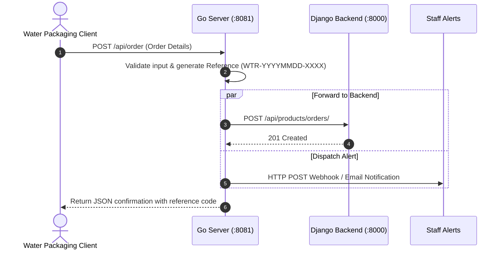
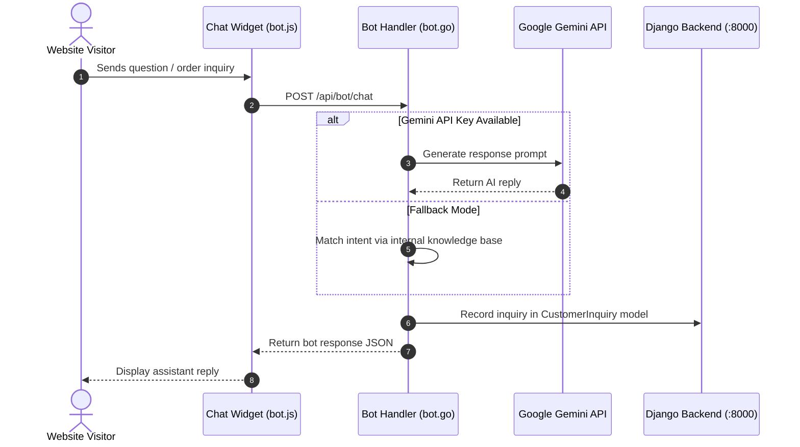

a# Jirmass Architecture

This document details the software architecture, component relationships, data flow, and directory structure of the **Jirmass** water packaging platform.

---

## 1. System Overview

Jirmass is an industrial web application designed for a water packaging manufacturer specializing in **Water Packing Bags** and **Water Packing Rolls** (sachet water film). The application utilizes a hybrid dual-service architecture:

- **Go Web Server (`:8081`)**: Acts as the customer-facing frontend, template renderer, static asset server, and lightweight API gateway for order intake and automated bot communication.
- **Django REST Framework (`:8000`)**: Operates as the administrative backend, handling persistent storage (SQLite), order lifecycle management, customer inquiry logging, and staff notifications.

---

## 2. High-Level Architecture Diagram

```mermaid
flowchart TD
    subgraph Client ["Client Browser"]
        BrowserUI["Web UI (home.html, about.html, contact.html)"]
        ChatWidget["Support Bot Widget (bot.js)"]
        OrderForm["Direct Order Form (order.js)"]
    end

    subgraph GoServer ["Go Web Server & API Gateway (:8081)"]
        Router["HTTP Router (main.go)"]
        PageHandlers["Page Renderers (Home, About, Contact)"]
        OrderHandler["Direct Order Handler (/api/order)"]
        BotHandler["Support Bot Handler (/api/bot/chat)"]
        LocalKB["Heuristic Rule-Based Knowledge Base"]
    end

    subgraph DjangoBackend ["Django REST Framework Backend (:8000)"]
        AdminDashboard["Django Admin (/admin/)"]
        ProductsApp["Products & Orders App (products/)"]
        DRFViews["REST Endpoints (/api/products/...)"]
        DjangoORM["Django ORM Models"]
        DB[(SQLite Database - db.sqlite3)]
    end

    subgraph External ["External Services"]
        GeminiAPI["Google Gemini LLM API"]
        Alerts["Email (SMTP) & Webhook Endpoints"]
    end

    BrowserUI -->|GET / /about /contact| Router
    OrderForm -->|POST /api/order| OrderHandler
    ChatWidget -->|POST /api/bot/chat| BotHandler

    Router --> PageHandlers
    Router --> OrderHandler
    Router --> BotHandler

    BotHandler -->|LLM Query (if configured)| GeminiAPI
    BotHandler -->|Offline / Fallback| LocalKB

    OrderHandler -->|POST /api/products/orders/| DRFViews
    BotHandler -->|POST /api/products/inquiries/| DRFViews

    AdminDashboard --> DjangoORM
    DRFViews --> DjangoORM
    DjangoORM --> DB

    OrderHandler -.->|Webhook Alert| Alerts
    DjangoORM -.->|Email & Webhook Alerts| Alerts
```

---

## 3. Component Breakdown

### A. Frontend & Gateway Layer (Go 1.22+)
- **Location**: Root directory (`./`)
- **Primary Files**:
  - `main.go`: Implements `SetupRouter()`, `HomeHandler()`, `AboutHandler()`, `ContactHandler()`, and `DirectOrderHandler()`.
  - `bot.go`: Automated assistant supporting Google Gemini integration with a deterministic rule-based knowledge fallback.
  - `main_test.go`: Unit and integration test suite covering routing, orders, and bot communication.
  - `templates/`: HTML templates using Go's `html/template` engine.
  - `static/`: CSS styling (`static/css/style.css`), client scripts (`static/js/order.js`, `static/js/bot.js`), and brand graphics (`static/images/`).

### B. Backend API & Administration Layer (Python 3.12+ & Django DRF)
- **Location**: `backend/`
- **Primary Components**:
  - `backend/config/`: Django core configuration (`settings.py`, `urls.py`, `wsgi.py`, `asgi.py`).
  - `backend/products/models.py`:
    - `Order` & `OrderItem`: Order storage, pricing, and fulfillment state.
    - `CustomerInquiry`: Messages submitted through the web form or automated bot.
    - `AdminAvailability`: Admin online/away toggle, away messages, and notification settings.
    - `BrandAsset`: Dynamic visual asset storage (logos, favicons, hero graphics).
  - `backend/products/views.py`: Django REST Framework API endpoints.
  - `backend/products/serializers.py`: JSON serialization and input validation.
  - `backend/products/admin.py`: Django Admin management interfaces.

---

## 4. End-to-End Data Flows

### Direct Order Submission


### Customer Support Chat Flow


---

## 5. Directory Map

```text
jirmass/
├── ARCHITECTURE.md             # This architecture documentation file
├── AGENTS.md                   # Agent guidelines, rules, and workflows
├── go.mod                      # Go module definition
├── main.go                     # Go server entrypoint and route handlers
├── bot.go                      # 24/7 AI and heuristic customer support bot
├── main_test.go                # Go tests for server, orders, and bot
├── static/                     # Static assets
│   ├── css/style.css           # Global stylesheet
│   ├── js/bot.js               # Client-side chatbot logic
│   ├── js/order.js             # Client-side direct order logic
│   └── images/                 # Logo and industrial background SVGs
├── templates/                  # Server-rendered HTML pages
│   ├── home.html               # Homepage & order form
│   ├── about.html              # Manufacturing standards
│   └── contact.html            # Inquiry form
└── backend/                    # Django REST Framework backend
    ├── manage.py               # Django CLI management script
    ├── requirements.txt        # Python backend dependencies
    ├── config/                 # Django settings and root URLs
    └── products/               # Products, orders, and inquiries app
        ├── admin.py            # Django Admin registration
        ├── models.py           # Database models
        ├── serializers.py      # Serializers
        ├── urls.py             # Backend REST endpoints
        └── views.py            # API views
```

---

## 6. Runtime Configuration & Environment Variables

| Variable | Target Component | Default | Description |
|---|---|---|---|
| `GEMINI_API_KEY` / `LLM_API_KEY` | Go Server (`bot.go`) | `""` | Google Gemini API key for dynamic AI support responses. |
| `LLM_MODEL` | Go Server (`bot.go`) | `gemini-1.5-flash` | Gemini model variant to use. |
| `ADMIN_WEBHOOK_URL` | Go Server & Django | `""` | Destination webhook URL for instant staff alerts. |
| `DJANGO_API_URL` | Go Server (`bot.go`) | `http://localhost:8000/api/products` | REST endpoint for backend synchronization. |

---

## 7. Starting the Services

### Go Web Server
```bash
go run .
# Accessible at http://localhost:8081
```

### Django Backend
```bash
cd backend
python manage.py migrate
python manage.py runserver 8000
# Accessible at http://localhost:8000 (Admin at /admin/)
```
