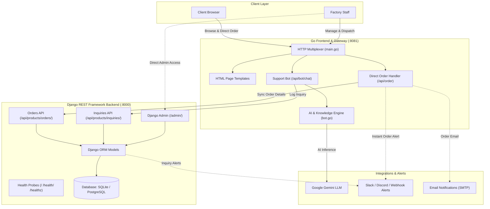

# Jirmass — Water Packaging Manufacturing Platform

[](https://go.dev/)
[](https://python.org/)
[](https://www.djangoproject.com/)
[](https://www.django-rest-framework.org/)
[](https://www.docker.com/)
[](https://render.com/)
[](https://vercel.com/)

**Jirmass** is a dual-service manufacturing and e-commerce web platform engineered specifically for industrial water packaging manufacturers. It powers direct wholesale ordering, product catalog showcases, automated 24/7 AI-driven customer support, and administrative order lifecycle management for water packaging rolls, custom printed films, outer packing bags, and industrial shrink wrap.

---

## Table of Contents

- [Key Features](#key-features)
- [Product Focus](#product-focus)
- [Architecture & Tech Stack](#architecture--tech-stack)
- [Directory Structure](#directory-structure)
- [Quick Start](#quick-start)
  - [Option A: Docker Compose (Recommended)](#option-a-docker-compose-recommended)
  - [Option B: Running Bare-Metal / Local Dev](#option-b-running-bare-metal--local-dev)
- [Environment Configuration](#environment-configuration)
- [Cloud Deployment](#cloud-deployment)
  - [Render Blueprint](#render-blueprint)
  - [Vercel](#vercel)
- [Testing & Quality Assurance](#testing--quality-assurance)
- [API Reference](#api-reference)
- [Contributing & Guidelines](#contributing--guidelines)
- [License](#license)

---

## Key Features

- **Blazing Fast Go Frontend & Gateway (`:8081`)**:
  - Pure Go 1.22+ web server leveraging `net/http` and `html/template` with sub-millisecond page renders.
  - Interactive wholesale **Direct Order Form** generating unique trackable order references (`WTR-YYYYMMDD-XXXX`).
  - Customer account portal and password-authenticated operations portal for factory staff.
  - Strict security headers (`X-Content-Type-Options`, `X-Frame-Options`, `Referrer-Policy`) and cached static delivery.

- **Intelligent 24/7 Hybrid Support Bot**:
  - Autonomous customer assistant powered by the **Google Gemini API** (`gemini-1.5-flash`).
  - Robust offline fallback to a local deterministic heuristic knowledge base for zero-downtime operation without API keys.
  - Real-time admin availability detection (online vs. away messaging with factory operating hours).

- **Robust Django REST Framework Backend (`:8000`)**:
  - Full-featured **Django Admin** interface (`/admin/`) for order dispatching, product management, and customer inquiry triage.
  - Multi-database support: SQLite for instant zero-dependency development, PostgreSQL for production.
  - Automatic database seeding with industrial water packaging specifications on initial boot.

- **Real-Time Staff & Admin Notifications**:
  - Asynchronous webhook dispatch (compatible with Slack, Discord, Zapier, WhatsApp business gateways).
  - Multi-channel email alerts triggered when wholesale orders are received or when inquiries arrive while staff is offline.

---

## Product Focus

Jirmass is tailored exclusively for pure water packaging and sachet water production facilities:

| Product | Specifications | Typical Use Case |
|---|---|---|
| **Plain Water Roll Film** | 320mm / 40–80 micron food-grade virgin LDPE | Automatic form-fill-seal (FFS) sachet water packaging machines |
| **Custom Printed Film** | 2–6 color rotogravure high-precision printing | Branded pure water sachets with NAFDAC/regulatory registration marks |
| **Printed Packing Bags** | Heavy-duty outer bagging sacks (20-sachet capacity) | Bundling and transporting sachet units from factory floor to distributor |
| **Shrink Wrap (SSB & MSB)** | Single-Sheet & Multi-Sheet high-tensile shrink film | Secure secondary bundling and pallet stabilization |

---

## Architecture & Tech Stack

Jirmass implements a decoupled, hybrid architecture combining Go's concurrency and raw performance with Django's administrative agility:



---

## Directory Structure

```text
jirmass/
├── main.go                     # Go web server, router, order handler, and session manager
├── bot.go                      # Support bot controller with Gemini integration & local KB
├── main_test.go                # Go unit and integration tests (orders, bot, pages, auth)
├── Dockerfile                  # Multi-stage production container for Go frontend
├── Dockerfile.django           # Hardened production container for Django backend
├── docker-compose.yml          # Multi-container local orchestration
├── render.yaml                 # Render Infrastructure-as-Code Blueprint
├── vercel.json                 # Vercel serverless deployment specification
├── static/                     # Static client-side assets
│   ├── css/style.css           # Global stylesheet and responsive layouts
│   ├── js/bot.js               # Chatbot widget UI controller
│   ├── js/order.js             # Direct order form validation & submission handler
│   └── images/                 # Product photography, brand SVGs, and vector backdrops
├── templates/                  # Go HTML5 templates
│   ├── home.html               # Product showcase & Direct Order section
│   ├── about.html              # Manufacturing & food safety standards
│   ├── contact.html            # Contact & sales inquiry form
│   ├── register.html           # Customer account registration
│   ├── login.html              # Customer & staff authentication
│   ├── account.html            # Customer order history dashboard
│   └── portal.html             # Protected staff operations dashboard
└── backend/                    # Django REST Framework application
    ├── manage.py               # Django management CLI
    ├── requirements.txt        # Python backend dependencies
    ├── entrypoint.sh           # Container entrypoint with migrations & Gunicorn boot
    ├── gunicorn.conf.py        # Production Gunicorn configuration
    ├── config/                 # Django project settings & root routing
    │   ├── settings.py         # App config, database, security headers & CSRF
    │   └── urls.py             # Root URL routing & RFC 9110 health probes
    └── products/               # Products, orders, and inquiries Django app
        ├── admin.py            # Model admin registration
        ├── models.py           # Order, OrderItem, CustomerInquiry, AdminAvailability
        ├── serializers.py      # Django REST Framework serializers
        ├── views.py            # REST API endpoints & health checks
        └── tests.py            # Comprehensive backend unit test suite
```

---

## Quick Start

### Option A: Docker Compose (Recommended)

Get the complete stack (Go frontend + Django backend + database) running with a single command:

```bash
# 1. Clone the repository
git clone https://github.com/your-username/jirmass.git
cd jirmass

# 2. Launch all services
docker compose up --build
```

- **Customer Frontend**: [`http://localhost:8081`](http://localhost:8081)
- **Django Backend & Admin**: [`http://localhost:8000`](http://localhost:8000) (Admin at [`http://localhost:8000/admin/`](http://localhost:8000/admin/))
- **Health Probes**: [`http://localhost:8081/healthz`](http://localhost:8081/healthz) and [`http://localhost:8000/healthz`](http://localhost:8000/healthz)

---

### Option B: Running Bare-Metal / Local Dev

#### 1. Start the Django REST Backend

```bash
cd backend

# Create virtual environment and install dependencies
python3 -m venv .venv
source .venv/bin/activate    # On Windows: .venv\Scripts\activate
pip install -r requirements.txt

# Apply migrations and seed initial products
python manage.py migrate
python manage.py seed_water_products

# Create administrative user (optional, for /admin/ access)
python manage.py createsuperuser

# Start Django development server on port 8000
python manage.py runserver 8000
```

#### 2. Start the Go Frontend

In a separate terminal, from the project root:

```bash
# Verify Go 1.22+ is installed
go version

# Run the Go web server (defaults to port 8081)
go run .
```

Open [`http://localhost:8081`](http://localhost:8081) in your browser.

---

## Environment Configuration

Configure the application by creating a `.env` file or exporting environment variables:

### Go Frontend Server

| Variable | Default | Purpose |
|---|---|---|
| `PORT` | `8081` | Web server port for customer traffic |
| `BACKEND_URL` | `http://localhost:8000` | URL pointing to the Django REST API |
| `GEMINI_API_KEY` | *(empty)* | Google Gemini API key for dynamic AI support |
| `LLM_MODEL` | `gemini-1.5-flash` | Gemini model variant |
| `ADMIN_WEBHOOK_URL` | *(empty)* | Webhook endpoint for order and inquiry alerts |

### Django Backend

| Variable | Default | Purpose |
|---|---|---|
| `PORT` | `8000` | Gunicorn/Django listening port |
| `DJANGO_DEBUG` | `True` | Debug mode (`False` in production) |
| `DJANGO_SECRET_KEY` | *(insecure default)* | Production cryptographic secret key |
| `DATABASE_URL` | *(SQLite)* | PostgreSQL connection string (e.g. on Render) |
| `DJANGO_ALLOWED_HOSTS` | `localhost,127.0.0.1` | Allowed Host header domains |
| `DJANGO_CSRF_TRUSTED_ORIGINS` | *(empty)* | Trusted origins for CSRF protection |
| `DJANGO_DEFAULT_FROM_EMAIL` | `sales@jirmassplastics.com` | From email address for notifications |
| `ADMIN_WEBHOOK_URL` | *(empty)* | Destination for backend webhook notifications |

---

## Cloud Deployment

### Render Blueprint

Jirmass includes a pre-configured [`render.yaml`](render.yaml) Infrastructure-as-Code blueprint for deploying on [Render](https://render.com):

1. Connect your repository to Render.
2. Select **Blueprints** and choose your repository.
3. Render automatically provisions:
   - A managed **PostgreSQL** database (`jirmass-db`).
   - The **Django REST Backend** (`jirmass-backend`) running in Docker with automatic database migrations and Gunicorn.
   - The **Go Web Application** (`jirmass-frontend`) connected seamlessly to the backend.

### Vercel

The frontend is ready for serverless deployment on [Vercel](https://vercel.com) using [`vercel.json`](vercel.json) and Python WSGI bridges in [`api/`](api/).

---

## Testing & Quality Assurance

### Go Frontend Test Suite

Runs HTTP integration tests covering routing, order submission, bot heuristics, authentication, and security headers:

```bash
go test -v ./...
go vet ./...
```

### Django Backend Test Suite

Runs comprehensive Django tests verifying models, serializers, API endpoints, alerts, and RFC 9110 health check compliance:

```bash
cd backend
python manage.py test products
python manage.py check
```

---

## API Reference

### Go Frontend Endpoints (`:8081`)

| Method | Path | Description |
|---|---|---|
| `GET` | `/` | Factory homepage & interactive Direct Order form |
| `GET` | `/about` | Film quality, extrusion, and hygiene standards |
| `GET` | `/contact` | Sales contact details and inquiry form |
| `POST` | `/api/order` | Direct wholesale order placement |
| `POST` | `/api/bot/chat` | Customer assistant message processor |
| `GET` | `/api/bot/status` | Bot status and factory operating hours |
| `GET` | `/account` | Authenticated customer order dashboard |
| `GET` | `/admin-portal` | Protected staff operations dashboard |
| `GET` | `/healthz` | Go gateway health probe |

### Django Backend Endpoints (`:8000`)

| Method | Path | Description |
|---|---|---|
| `GET`, `HEAD` | `/` | Lightweight health check (RFC 9110 compliant) |
| `GET`, `HEAD` | `/health/` | Health check endpoint |
| `GET`, `HEAD` | `/healthz` | Deep system & database connectivity probe |
| `GET`, `POST` | `/api/products/orders/` | Order creation and listing |
| `GET`, `POST` | `/api/products/inquiries/` | Customer inquiry management |
| `GET`, `POST` | `/api/products/admin-status/`| Admin online/away toggle |
| `GET` | `/admin/` | Django Admin administrative portal |

---

## Contributing & Guidelines

Contributions are welcome! Please follow these standards:

1. Follow standard Go conventions (`go fmt`, `go vet`).
2. Adhere to PEP 8 for Python and ensure all Django migrations are generated sequentially via `makemigrations`.
3. Never commit build artifacts, binaries, or SQLite database files (`db.sqlite3`).
4. Read [`AGENTS.md`](AGENTS.md) and [`ARCHITECTURE.md`](ARCHITECTURE.md) for deeper implementation guidelines.

---

## License

This project is licensed under the [MIT License](LICENSE).
